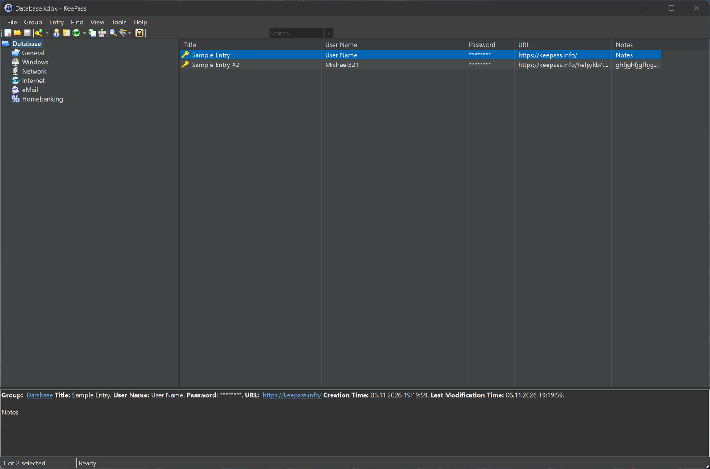
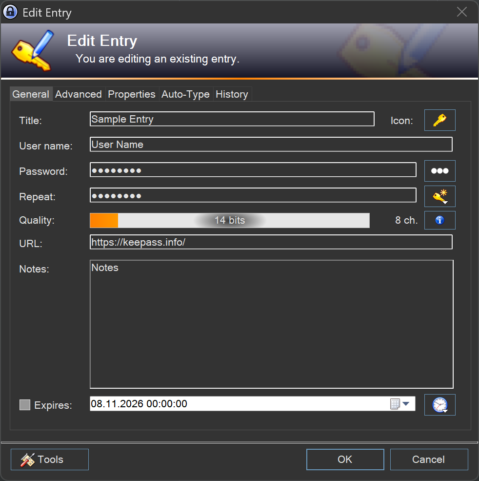
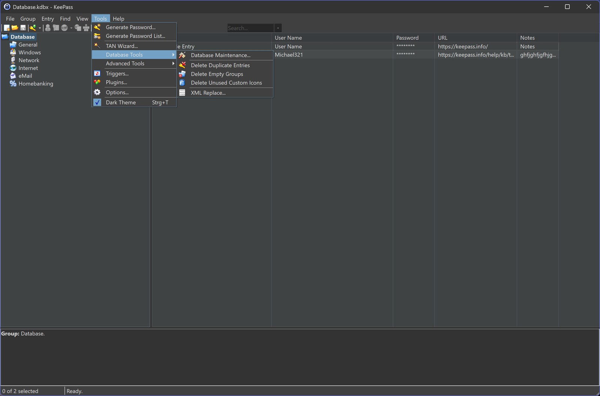
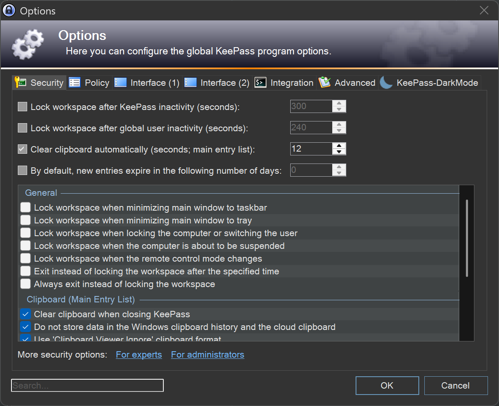

# 🌙 KeePass-DarkMode

<p align="center">
  
  
  <a href="https://github.com/JImmyB0nes/KeePass-DarkMode/releases/latest"></a>
  <a href="https://github.com/JImmyB0nes/KeePass-DarkMode/releases/latest/download/KeePassDarkMode.plgx"></a>
</p>

<p align="center">
  <strong>Dunkles Theme für KeePass 2.x — augenfreundlich, auch nachts.</strong><br>
  Kein Umstieg, kein Funktionsverlust: Alles bleibt, nur die Optik ändert sich.
</p>

---

## Inhalt

- [Screenshots](#-screenshots)
- [Quick Start](#-quick-start)
- [Installation](#-installation)
- [Features](#-features)
- [Eigene Themes](#-eigene-themes)
- [Troubleshooting](#-troubleshooting)
- [Kompatibilität](#-kompatibilität)
- [Entwicklung](#-entwicklung)

---

## 📸 Screenshots

| Hauptfenster im Dark Mode | Bearbeiten-Dialog |
|---|---|
|  |  |

| Tools-Menü mit Dark-Theme-Schalter | Optionen (Reiter KeePass-DarkMode) |
|---|---|
|  |  |

| Theme-Konfiguration mit Live-Vorschau |
|---|
|  |

---

## ⚡ Quick Start

```
STRG + T          Theme umschalten
```

Alternativ über das Menü: **Tools → Dark Theme**

---

## 🚀 Installation

1. **[KeePassDarkMode.plgx](https://github.com/JImmyB0nes/KeePass-DarkMode/releases/latest/download/KeePassDarkMode.plgx)** von der Release-Seite herunterladen
2. In den Plugin-Ordner kopieren — je nach KeePass-Version:

   | Version | Pfad |
   |---|---|
   | KeePass Standard | `C:\Program Files (x86)\KeePass Password Safe 2\Plugins\` |
   | Pleasant PPS | `C:\Program Files (x86)\Pleasant Solutions\KeePass for Pleasant Password Server\Plugins\` |

3. KeePass neu starten — fertig.

> [!TIP]
> Alternativ: **Tools → Plugins → Add…** und die `.plgx` dort reinziehen. KeePass lädt und aktiviert Plugins dann zur Laufzeit.

---

## ✨ Features

| | |
|---|---|
| 🌑 **Dunkles Theme** | Ruhige, moderne Farbpalette für die gesamte KeePass-Oberfläche |
| ⌨️ **Hotkey** | `STRG+T` zum Umschalten — frei konfigurierbar |
| 🎨 **Theme-Editor** | Eigene Farbwelten per GUI erstellen, ohne Textdateien zu editieren |
| 🪟 **Windows-11-Support** | Eigenes Theme mit Windows-11-Flair (`DarkThemeWin11.ini`) |
| 📦 **Plgx-Format** | Ein Dateisprung installiert/updatet das Plugin — ohne Kompilieren |
| 🔧 **Theme-Erkennung** | Folgt dem Windows-Farbschema — im Dunkel-Modus aktiv, im Hell-Modus aus |
| 🎨 **Windows-Akzent** | optional: übernimmt die Windows-Akzentfarbe für Highlights |
| 🔔 **Update-Hinweis** | zeigt eine neue Version direkt im Menü unter *Tools* an |

---

## 🎨 Eigene Themes

Mit dem eingebauten Theme-Editor erstellst du im Handumdrehen eigene Farbwelten:

Eigene Theme-Dateien (`.ini`) einfach in den Plugin-Ordner legen — sie erscheinen automatisch in der Auswahl unter **Tools → Optionen → KeePass-DarkMode**.

Zwei Startpunkte liegen bei:

| Theme | Beschreibung |
|---|---|
| `DarkTheme.ini` | Klassisches dunkles Theme |
| `DarkThemeWin11.ini` | An Windows-11-Optik angepasst |

---

## 🔧 Troubleshooting

### Plugin-Cache leeren

Nach einem Update kann ein veralteter Plugin-Cache für Lade-Probleme sorgen. Dazu einfach `%LOCALAPPDATA%\KeePass\PluginCache\` (bei Pleasant PPS: `%LOCALAPPDATA%\PleasantKeePass\PluginCache\`) löschen und KeePass neu starten.

### Bestimmte Bereiche bleiben hell

KeePass nutzt klassische Windows-Controls, die sich nur eingeschränkt umfärben lassen. Einzelne Stellen (z. B. bestimmte Dialoge und Systemmenüs) können hell bleiben — alltagstauglich, aber kein kompromissloses Pixel-Perfect-Theming.

---

## 🧩 Kompatibilität

- **KeePass:** 2.4x und neuer (gegen 2.42 gebaut, lauffähig mit aktuellen Versionen)
- **Windows:** 10 und 11
- **.NET Framework:** 4.0 oder neuer

---

## 🛠️ Entwicklung

```bash
# Build unter Windows (benötigt .NET Framework 4.x)
msbuild KeePass-DarkMode.sln /p:Configuration=Release

# plgx-Paket erzeugen
cd build && build.cmd
```

Gebaut wird unter Windows mit MSBuild (.NET Framework 4.x) — GitHub Actions sind deaktiviert, die Builds laufen lokal bzw. auf einer separaten Build-Maschine.

**Wichtig beim plgx-Bauen:** KeePass übernimmt den `BaseFileName` aus `<AssemblyName>` der `.csproj` und erwartet daraus abgeleitet die Plugin-Klasse `<AssemblyName>.<AssemblyName>Ext`. Dateiname, Assembly-Name und Klassenname müssen übereinstimmen.
