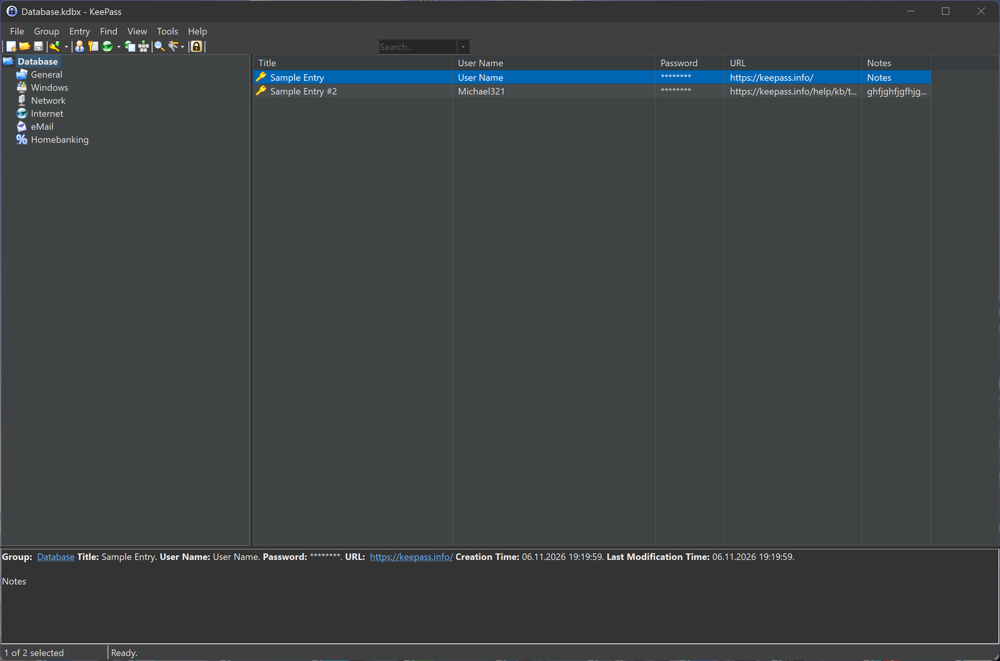
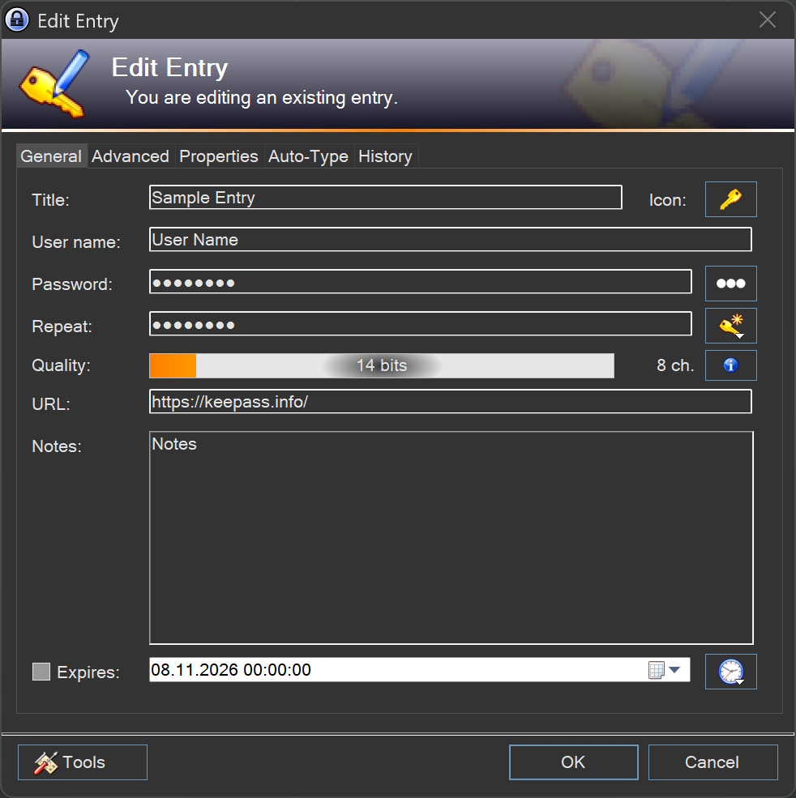
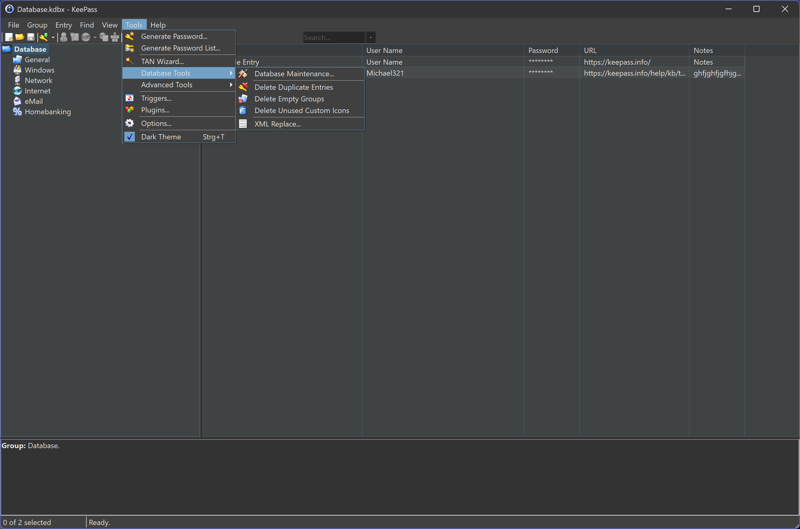
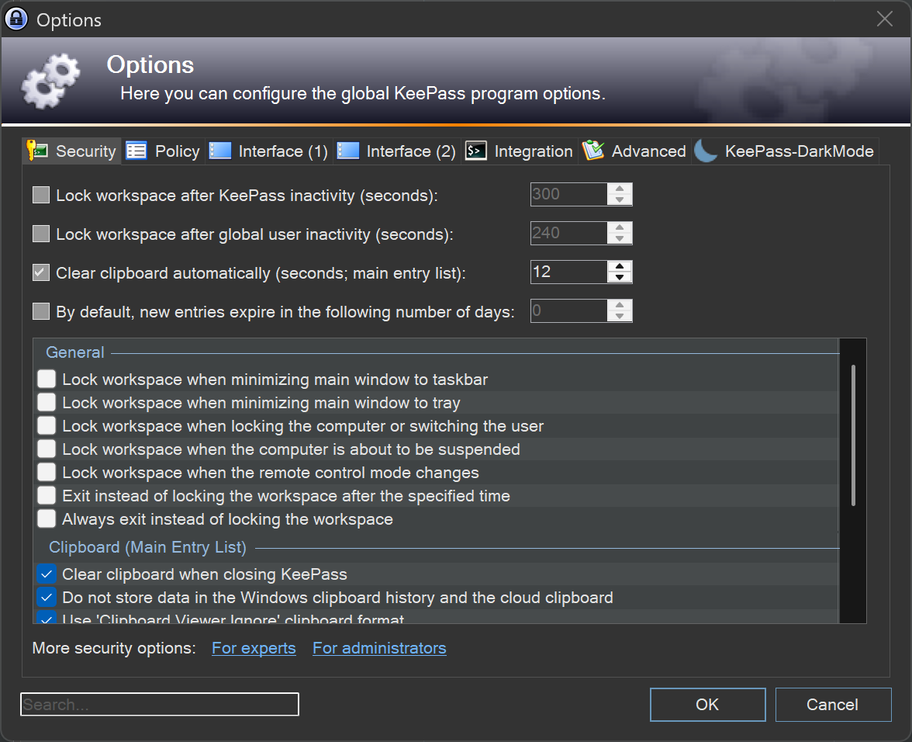

# 🌙 KeePass-DarkMode

<p align="center">
  
  
  <a href="https://github.com/JImmyB0nes/KeePass-DarkMode/releases/latest"></a>
  <a href="https://github.com/JImmyB0nes/KeePass-DarkMode/releases/latest/download/KeePassDarkMode.plgx"></a>
</p>

<p align="center">
  <strong>A dark theme for KeePass 2.x — easy on the eyes, even at night.</strong><br>
  No migration, no lost features: everything stays, only the look changes.
</p>

---

## Contents

- [Screenshots](#-screenshots)
- [Quick Start](#-quick-start)
- [Installation](#-installation)
- [Features](#-features)
- [Custom Themes](#-custom-themes)
- [Troubleshooting](#-troubleshooting)
- [Compatibility](#-compatibility)
- [Development](#-development)

---

## 📸 Screenshots

| Main window in dark mode | Edit entry dialog |
|---|---|
|  |  |

| Tools menu with dark-theme toggle | Options (KeePass-DarkMode tab) |
|---|---|
|  |  |

| Theme configuration with live preview |
|---|
|  |

---

## ⚡ Quick Start

```
CTRL + T          Toggle theme
```

Alternatively via the menu: **Tools → Dark Theme** (the menu item shows the name of the active theme)

---

## 🚀 Installation

1. Download **[KeePassDarkMode.plgx](https://github.com/JImmyB0nes/KeePass-DarkMode/releases/latest/download/KeePassDarkMode.plgx)** from the release page
2. Copy it into the plugin folder — depending on your KeePass version:

   | Version | Path |
   |---|---|
   | KeePass standard | `C:\Program Files\KeePass Password Safe 2\Plugins\` |
   | KeePass standard (older 32-bit install) | `C:\Program Files (x86)\KeePass Password Safe 2\Plugins\` |
   | Pleasant PPS | `C:\Program Files (x86)\Pleasant Solutions\KeePass for Pleasant Password Server\Plugins\` |

3. Restart KeePass — done.

> [!TIP]
> You can open the plugin folder directly via **Tools → Plugins → Open Plugin Folder...**. KeePass only loads plugins at startup — after copying the file, a restart is required.

---

## ✨ Features

| | |
|---|---|
| 🌑 **Dark theme** | Calm, modern color palette for the entire KeePass UI |
| 🎨 **Five themes** | Default, Windows 11, Dracula, Colorblind and High Contrast — switchable from a dropdown |
| ⌨️ **Hotkey** | `CTRL+T` to toggle — fully configurable |
| 🖌️ **Theme editor** | Create your own color schemes via GUI, no editing of text files required |
| 📦 **Plgx format** | A single file installs/updates the plugin — no compiling needed |
| 🔧 **Theme detection** | Follows the Windows color scheme — active in dark mode, inactive in light mode |
| 🎨 **Windows accent** | Optional: uses the Windows accent color for highlights |
| 🔔 **Update notice** | Shows a new version directly in the *Tools* menu |
| 🪟 **Flicker-free** | Dialogs and text boxes are built dark before their first paint |
| 🖥️ **Native dialogs** | Message boxes and windows get a dark title bar |

---

## 🎨 Custom Themes

Use the built-in theme editor to create your own color schemes in no time:

Simply drop your own theme file (`.ini`) into the plugin folder — it appears automatically in the selection under **Tools → Options → KeePass-DarkMode**.

Five bundled themes are included:

| Theme | Description |
|---|---|
| `DarkTheme.ini` | Classic dark theme (default) |
| `DarkThemeWin11.ini` | Matched to the Windows 11 look |
| `DarkThemeDracula.ini` | Based on the Dracula palette |
| `DarkThemeColorblind.ini` | Contrast tuned for color vision deficiency |
| `DarkThemeHighContrast.ini` | High contrast for accessible viewing |

---

## 🔧 Troubleshooting

### Clear the plugin cache

After an update, a stale plugin cache can cause loading problems. Simply delete `%LOCALAPPDATA%\KeePass\PluginCache\` (for Pleasant PPS: `%LOCALAPPDATA%\PleasantKeePass\PluginCache\`) and restart KeePass.

### Some areas stay light

KeePass uses classic Windows controls that can only be recolored to a limited extent. Individual spots (e.g. certain dialogs and system menus) may remain light — practical for daily use, but not a pixel-perfect theming.

---

## 🧩 Compatibility

- **KeePass:** 2.4x and newer (built against 2.42, runs with current versions)
- **Windows:** 10 and 11
- **.NET Framework:** 4.5 or newer

---

## 🛠️ Development

```bash
# Build on Windows (requires .NET Framework 4.5)
msbuild KeePass-DarkMode.sln /p:Configuration=Release

# Create the plgx package
cd build && build.cmd
```

Builds run on Windows with MSBuild (.NET Framework 4.5) — GitHub Actions are disabled; builds are produced locally or on a separate build machine.

**Important when building the plgx:** KeePass takes the `BaseFileName` from `<AssemblyName>` in the `.csproj` and derives the expected plugin class `<AssemblyName>.<AssemblyName>Ext` from it. File name, assembly name and class name must match.
