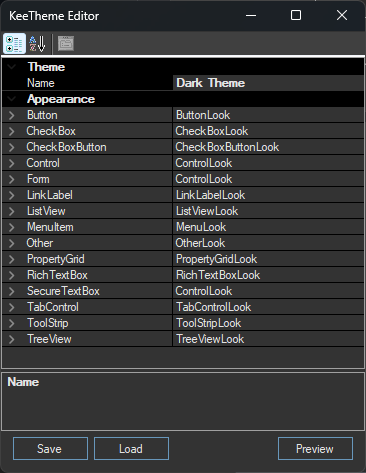

# 🌙 KeePass-DarkMode

[](https://github.com/jimmybonesde/KeePass-DarkMode/releases/latest)
[](https://github.com/jimmybonesde/KeePass-DarkMode/releases/latest/download/KeeTheme.plgx)

**Dunkles Theme für KeePass — augenfreundlich, auch nachts.**

KeePass-DarkMode verwandelt die helle Standardoberfläche von KeePass in ein ruhiges, dunkles Design. Kein Umstieg, kein Verlust: Alle Funktionen bleiben erhalten, nur die Optik ändert sich.

> **Umschalten:** `STRG+T` oder Menü **Tools → DarkTheme**

---

## ✨ Features

- 🌑 Modernes, dunkles Theme für die gesamte KeePass-Oberfläche
- ⌨️ Hotkey `STRG+T` zum schnellen Umschalten
- 🎨 Eigene Themes mit dem eingebauten Theme-Editor erstellen
- 💾 Automatische Aktualisierung über die KeePass-Plugin-Funktion

---

## 🚀 Installation

### Methode 1: Manuell

1. [KeeTheme.dll](https://github.com/jimmybonesde/KeePass-DarkMode/releases/latest/download/KeeTheme.dll) oder [KeeTheme.plgx](https://github.com/jimmybonesde/KeePass-DarkMode/releases/latest/download/KeeTheme.plgx) herunterladen
2. In den KeePass-Plugin-Ordner kopieren (Standard: `C:\Program Files (x86)\KeePass Password Safe 2\Plugins\`)
3. KeePass neu starten — fertig

### Methode 2: Über Chocolatey

```powershell
choco install keepass-plugin-keetheme
```

KeePass danach einmal neu starten.

---

## 🎨 Eigene Themes

Mit dem eingebauten Theme-Editor erstellst du im Handumdrehen eigene Farbwelten:



Eigene Theme-Dateien (`.ini`) einfach in den Plugin-Ordner legen — sie erscheinen dann automatisch in der Theme-Auswahl unter **Tools → Optionen → KeeTheme**.

---

## 💬 Hinweise

KeePass basiert auf klassischen Windows-Controls, die sich nur eingeschränkt umfärben lassen. Einzelne Bereiche können deshalb weiterhin hell erscheinen. Das Plugin ist so ausgereift wie möglich — gut genug für den Alltag, aber kein kompromettloses Pixel-Perfect-Theming.
